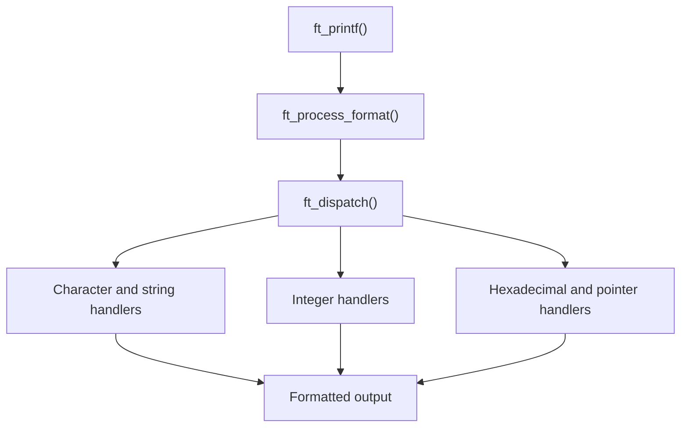

<div align="center">

# FT_PRINTF

*Rebuilding formatted output in C from scratch.*


</div>

> This project has been created as part of the 42 curriculum by aal-shat.

## 📖 About the project

ft_printf is a custom implementation of a subset of the standard C `printf()` function, developed as part of the 42 Common Core curriculum.

The objective is to understand variadic arguments, format parsing, numerical conversions and low-level output.

The function processes a format string, retrieves arguments using variadic macros, delegates conversions to specialized handlers and writes the resulting output to standard output.

It returns the number of characters printed, or a negative value if an output error occurs.

| Format specifiers | Language | Libft dependency | Output |
| :---: | :---: | :---: | :---: |
| 9 | C | None | `libftprintf.a` |

## 🧠 Concepts explored

- Variadic arguments: `va_list`, `va_start`, `va_arg` and `va_end`
- Format string parsing
- Recursion and numerical conversions
- Pointer representation
- Decimal and hexadecimal number systems
- Low-level output using `write()`
- Error handling and character counting
- Modular programming and static libraries

## 🏗️ Program architecture



The implementation separates format parsing, conversion dispatching and output generation into dedicated functions.

## 📚 Supported conversions

| Specifier | Description | Example output |
| :---: | --- | --- |
| `%c` | Single character | `A` |
| `%s` | String | `Hello` |
| `%p` | Pointer address in hexadecimal | `0x7ffd1234` |
| `%d` | Signed decimal integer | `-42` |
| `%i` | Signed integer | `42` |
| `%u` | Unsigned decimal integer | `4294967295` |
| `%x` | Lowercase hexadecimal | `ff` |
| `%X` | Uppercase hexadecimal | `FF` |
| `%%` | Literal percent sign | `%` |

This implementation focuses on the required conversions rather than the complete standard printf specification.

## ⚙️ Compilation

Requirements: a C compiler and GNU Make.

```bash
make
```

This generates the static library `libftprintf.a`.

| Command | Description |
|---|---|
| `make` | Build the library |
| `make clean` | Remove object files |
| `make fclean` | Remove object files and the library |
| `make re` | Rebuild the library from scratch |

## 🚀 Usage

Include `ft_printf.h` in your C program and link against the compiled library.

For a test program named `main.c` in the project directory:

```bash
cc -Wall -Wextra -Werror main.c libftprintf.a -o program
./program
```

Example function calls and their expected output:

| Function call | Output |
|---|---|
| `ft_printf("Hello %s!", "World")` | Hello World! |
| `ft_printf("Number: %d", -42)` | Number: -42 |
| `ft_printf("Hex: %x", 255)` | Hex: ff |
| `ft_printf("Progress: 100%%")` | Progress: 100% |

## 📂 Project structure

```text
ft_printf/
├── ft_printf.c           # Main entry point
├── ft_process_format.c   # Format string processing
├── ft_dispatch.c         # Conversion dispatching
├── ft_print_char.c       # Character output
├── ft_print_string.c     # String output
├── ft_print_number.c     # Signed integer output
├── ft_print_unsigned.c   # Unsigned integer output
├── ft_print_hex.c        # Hexadecimal conversion
├── ft_print_pointer.c    # Pointer representation
├── ft_printf.h           # Header declarations
├── Makefile              # Build automation
├── .gitignore            # Git exclusion rules
└── README.MD             # Project documentation
```

## 🧪 Testing considerations

Important cases to verify include:

- All nine supported format specifiers
- Empty strings and mixed conversions
- NULL strings and pointers
- Minimum and maximum integer values
- Consecutive percent signs
- Output errors
- Return values compared with standard printf

## 💡 What I learned

Through this project, I explored how a function can receive a variable number of arguments and interpret them through a format string.

Separating parsing, dispatching and conversion into dedicated functions strengthened my understanding of modular programming and made debugging easier.

I also developed a deeper understanding of numerical representations, pointer handling, recursion and low-level output.

## 🔗 Resources

- [Linux printf manual](https://man7.org/linux/man-pages/man3/printf.3.html)
- [Variadic arguments in C](https://en.cppreference.com/w/c/variadic.html)
- [GNU Make manual](https://www.gnu.org/software/make/manual/)
- Educational videos and AI-assisted conceptual learning

## 👨‍💻 Author

**Ammar Al Shater — aal-shat**

Software Engineering Student @ 42 Nice

[GitHub](https://github.com/Ammaralshater) · [LinkedIn](https://www.linkedin.com/in/ammar-al-shater-973161b4/)

---

<div align="center">
<sub>Building. Learning. Improving.</sub>
</div>
